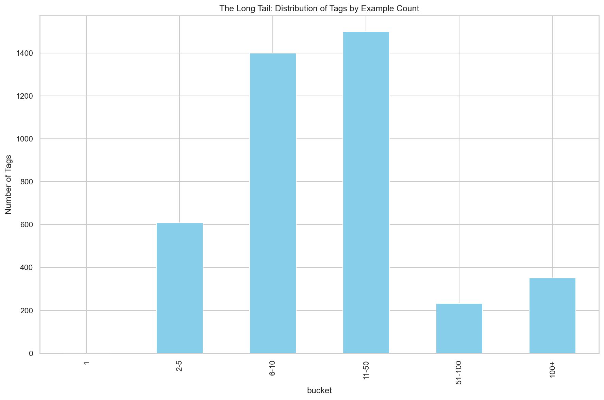
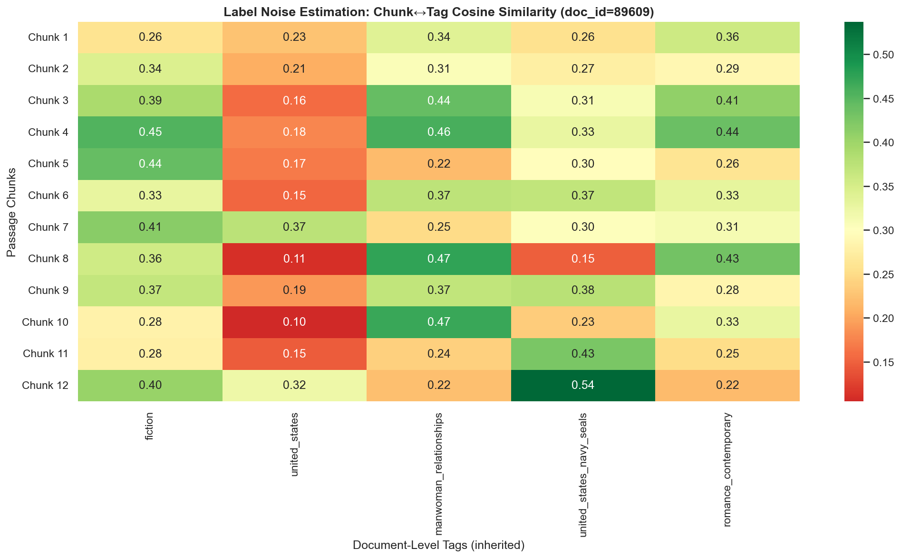
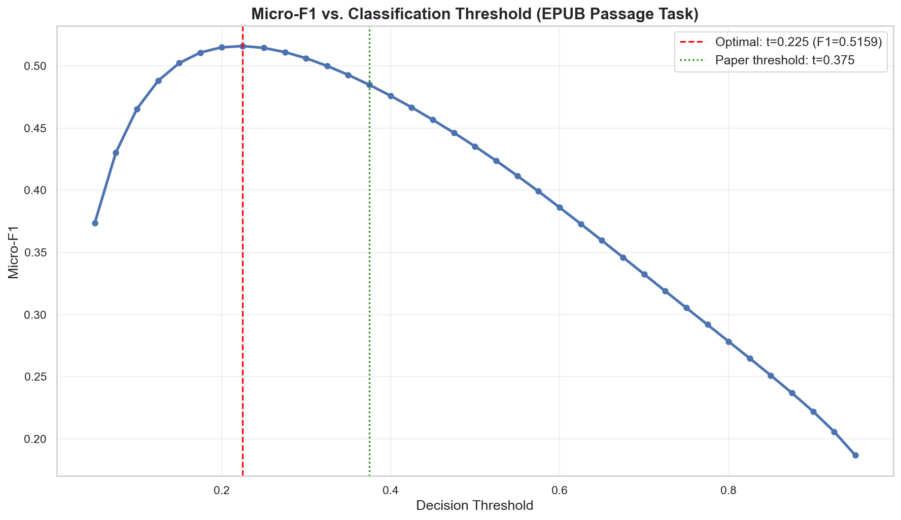
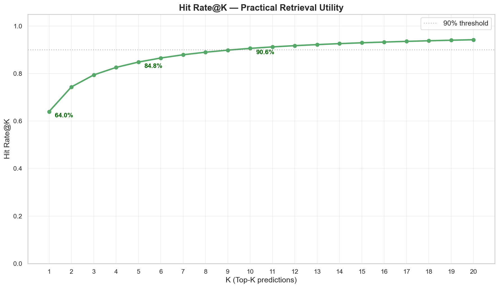
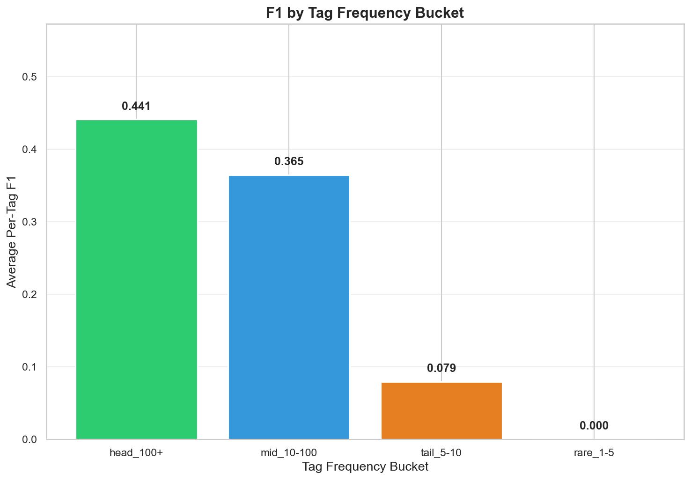
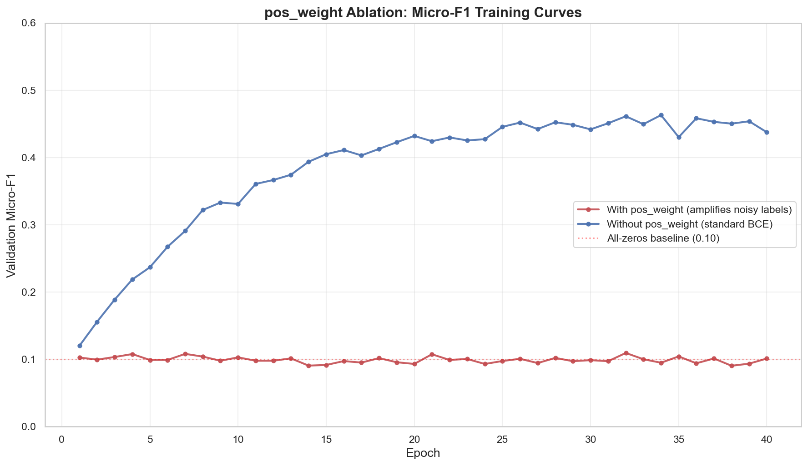
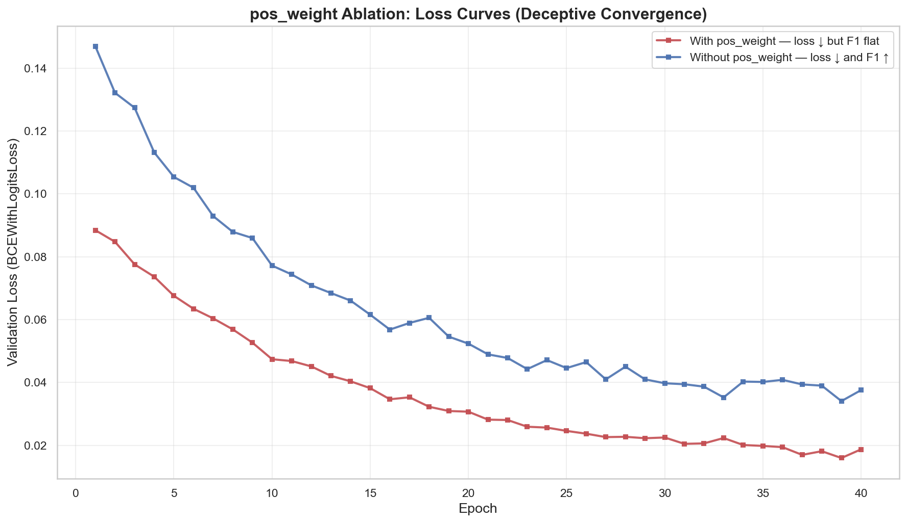
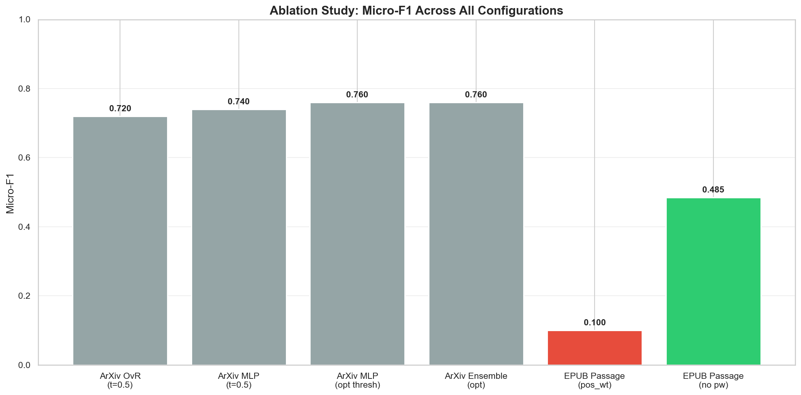
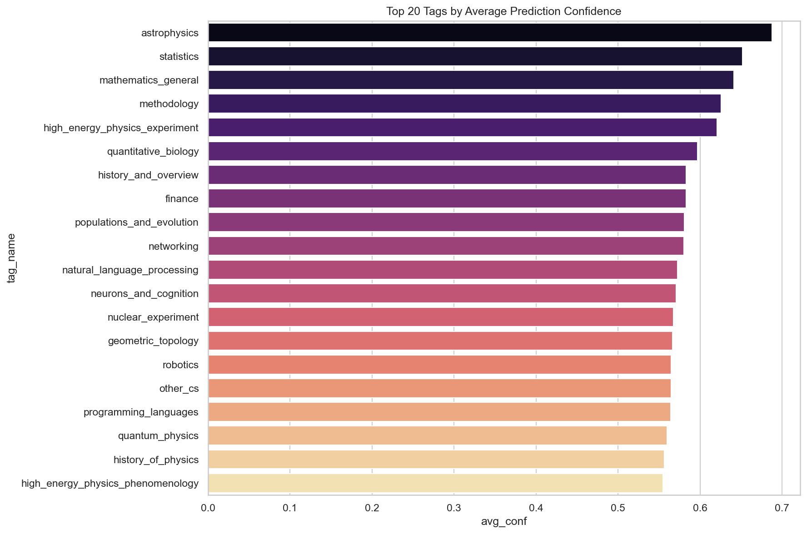
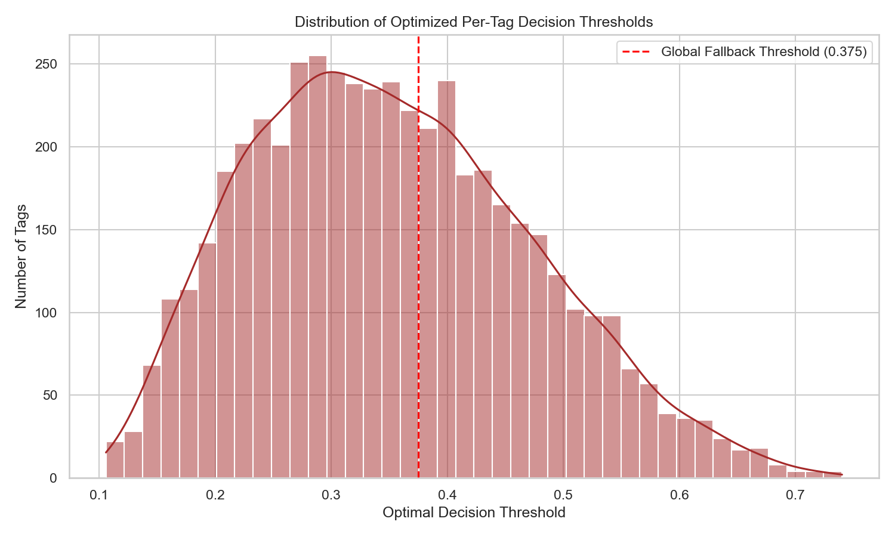

# Introduction

(MLC) offers a scalable solution to efficient document search, but
traditional approaches struggle with high-cardinality label spaces and
the cold-start problem in sparsely annotated domains.

The **Sentence Transformer Fine-Tuning (SetFit)** framework
[@tunstall_efficient_2022] addresses the data-efficiency problem by
decoupling contrastive representation learning from classifier training.
However, SetFit has been evaluated primarily on low-cardinality
benchmarks (5 to 20 labels), and its default logistic regression head
may not suffice when the label space spans thousands of categories. In
this paper, I present a production-scale extension of SetFit to a
120,905-document corpus with over 4,091 curated labels, replacing the
standard classification head with a deep MLP trained using
`BCEWithLogitsLoss`. Evaluated on the full passage-level corpus with
document-inherited labels, the system achieves Micro-F1 of 0.485 and Hit
Rate@5 of 0.848 at 1,401 passages per second; on the ArXiv-only subset
with clean document-level labels, Micro-F1 reaches 0.76. I also show
that naive `pos_weight` amplification catastrophically suppresses
learning under noisy label regimes while the architecture itself remains
sound.

# Contributions

This work makes the following contributions beyond prior research:

1.  **Scaling SetFit to high-cardinality multi-label classification.**
    The original SetFit framework [@tunstall_efficient_2022] was
    evaluated on 5--20 labels; I extend it to 4,091 simultaneous tags,
    demonstrating that the contrastive-then-classify paradigm remains
    effective at this scale.

2.  **Hybrid gold/silver label synthesis with provenance tracking.**
    Five label streams (EPUB metadata, filesystem structure, ISBN
    subject headings, ArXiv categories, and LLM-distilled labels) are
    unified in a single schema that tracks source and confidence. A
    SQLite trigger automatically replaces low-confidence predictions
    when higher-fidelity labels arrive.

3.  **Semantic label reduction.** Using an embedding model pre-trained
    on the corpus, tens of thousands of raw labels are pruned to only
    those carrying the greatest semantic weight.

4.  **Deep MLP classification head for SetFit.** Replacing the standard
    logistic regression head with a three-layer MLP
    (384$\rightarrow$`<!-- -->`{=html}512$\rightarrow$`<!-- -->`{=html}4,091)
    yields a 3--4 point Micro-F1 gain
    (Table [\[tab:ablation\]](#tab:ablation){reference-type="ref"
    reference="tab:ablation"}), confirming that non-linear capacity
    benefits high-cardinality label mapping.

5.  **Per-tag threshold optimization.** Sweeping decision boundaries
    independently for each of the 4,091 tags on the validation set
    yields an additional 3-point Micro-F1 gain over a fixed global
    threshold, with the largest impact on medium-frequency tags.

6.  **Analysis of `pos_weight` failure under label noise.** I
    demonstrate that naive class-imbalance correction via `pos_weight`
    catastrophically suppresses learning (Micro-F1 $\approx$ 0.10) when
    applied to passage-level labels inherited from document-level
    annotations. Removing `pos_weight` recovers Micro-F1 to 0.485, a
    0.385-point improvement. The gap between the clean ArXiv-only subset
    (0.76) and the full corpus (0.485) quantifies the cost of label
    noise inherent in document-inherited passage labels.

# Related Work

## Multi-Label Classification at Scale

Multi-label classification (MLC) has evolved from flat one-vs-rest
schemes toward architectures exploiting label correlations. Early TF-IDF
approaches scale poorly beyond a few hundred labels due to feature
sparsity [@abbas_automated_2023], while BERT-based fine-tuning improves
performance but remains computationally prohibitive when the label space
exceeds thousands of categories and annotated data is scarce [@minilm].
Established large-scale systems such as PubMed's MeSH indexer rely on
domain-specific ontologies and significant human curation, limiting
portability to new corpora.

Menke et al. demonstrated that `BCEWithLogitsLoss` with independent
sigmoid outputs outperforms softmax-based approaches for multi-label
publication tagging when label co-occurrence is common
[@menke_publication_2025]. This work extends that finding to a
substantially larger label space (4,091 tags) within the SetFit
paradigm.

## SetFit and Few-Shot Learning

Tunstall et al. introduced SetFit as an efficient alternative to
prompt-based few-shot learning, decoupling contrastive representation
learning from classifier training and achieving competitive performance
against GPT-3 using orders of magnitude less data
[@tunstall_efficient_2022]. However, original SetFit evaluations were
limited to low-cardinality tasks (5--20 labels), and the default
logistic regression head may not capture non-linear dependencies in
high-cardinality settings. This work addresses that gap by substituting
a deep MLP head and scaling contrastive pair generation to 1,598,044
examples across over 4,091 categories.

## Knowledge Distillation for Label Augmentation

Knowledge distillation from large language models has emerged as a
practical strategy for generating training labels where human annotation
is expensive [@hinton_distilling_2015]. I adopt a hybrid strategy
combining authoritative metadata (ISBN subjects and ArXiv categories)
with silver-standard labels from a locally hosted LLM, creating a label
hierarchy that explicitly tracks provenance and confidence.

# NLP Pipeline and Experimental Setup

I have architected the system as a modular suite of Python-based
processing tiers designed to feed the two-stage SetFit training loop
(Fig. [1](#fig:file_pipeline){reference-type="ref"
reference="fig:file_pipeline"}).

<figure id="fig:file_pipeline" data-latex-placement="!t">

<figcaption>ArXiv categories serve directly as gold labels. EPUB
documents are tagged via four sources: embedded OPF metadata (gold),
ISBN-to-OpenLibrary subject lookups (gold), filesystem path heuristics
(silver), and local LLM distillation (silver, dashed). All raw tags pass
through a semantic merge stage that uses MiniLM cosine similarity to
consolidate  ∼ 37, 684 tag variants
into  ∼ 4, 091 canonical categories
before stratified splitting and SetFit training.</figcaption>
</figure>

## Dataset Composition

The corpus consists of 120,905 documents drawn from two sources: 74,549
EPUB files extracted from a heterogeneous digital library and 46,356
ArXiv abstracts ingested from the Kaggle ArXiv metadata snapshot. Table
[1](#tab:dataset){reference-type="ref" reference="tab:dataset"}
summarizes the dataset composition.

::: {#tab:dataset}
  **Metric**                        **Value**
  ----------------------------- -------------
  Total documents processed           120,905
  Passages (chunks) generated      22,129,285
  Unique tags (vocabulary)              4,091
  Gold labels (ISBN + ArXiv)      82,880 docs
  Silver labels (LLM)                234 docs
  Corpus Size GB                    82.608 GB

  : Dataset and label source summary.
:::

## Tag Acquisition

Extracting useful tags from tens of thousands of documents required
multiple sourcing methods and a reduction pipeline to retain only
semantically valuable tags.

ArXiv tags were the simplest to acquire: 157 unique tags across 46,356
documents. EPUB tags required four additional methods:

- **ISBNs:** EPUBs with attached ISBNs were looked up against the
  OpenLibrary database, yielding 19,762 unique tags.

- **EPUB Metadata:** Parsing embedded XML metadata extracted 22,180
  additional tags.

- **File Paths:** Filesystem organization (e.g., "Physics", "Computer
  Science" folders) provided coarse but useful signal.

- **LLM Tagging:** A locally hosted GLM 4.7 generated tags for untagged
  documents; limited to a small subset due to computational cost.

This yielded 42,915 raw tags, most of which were unusable: $59.5\%$
occurred only once, and EPUB metadata frequently leaked ISBNs and other
noise. Label assignments by source are shown in
Fig. [2](#fig:tag_source_dist){reference-type="ref"
reference="fig:tag_source_dist"}: EPUB metadata (40.8%), ISBN (28.7%),
ArXiv (25.8%), file paths (4.2%), and LLM (0.4%).

The vocabulary was reduced via a five-step pipeline:

1.  **Regex junk removal.** Discarded numeric-leading strings (leaked
    ISBNs), BISAC codes, bestseller references, format descriptors,
    Lexile levels, fictional character tags, and strings exceeding 60
    characters. Eliminated approximately 3,529 tags.

2.  **Prefix/suffix normalization.** Collapsed trivial variants by
    stripping `fiction_`, `_fiction`, and `_general`, reducing
    `fiction_romance_general`, `romance_fiction`, and `romance` to a
    single canonical form.

3.  **Semantic deduplication.** Tag names were encoded with the
    fine-tuned `all-MiniLM-L6-v2` encoder and merged at cosine
    similarity $\geq$ 0.85, capturing synonyms invisible to string
    matching (e.g., `science_fiction`/`scifi`,
    `biography_autobiography`/`biographies`).

4.  **Frequency pruning.** Tags with fewer than 5 document-level
    occurrences were removed as insufficient for contrastive training.

5.  **Cross-source deduplication.** Where multiple sources assigned the
    same canonical tag to a document, only the highest-confidence
    assignment was retained.

This pipeline reduced the vocabulary from 42,915 raw tags to 4,091
canonical categories, each semantically distinct and sufficiently
supported.

<figure id="fig:tag_source_dist" data-latex-placement="htbp">

<figcaption>Distribution of tag assignments by source. EPUB embedded
metadata and ISBN subject lookups collectively account for the number of
all tag assignments, with ArXiv categories contributing 25.8%.
Filesystem path heuristics and LLM-distilled labels provide
supplementary coverage for documents lacking structured
metadata.</figcaption>
</figure>

## Surgical Cleaning and Semantic Noise Reduction

EPUB extractions via Pandoc [@pandoc] contain mathematical symbols,
tables, inline citations, and structural boilerplate that degrade
Sentence Transformer training. Cleaning proceeds in two passes within
`chunking.py`.

**1) Global Boilerplate Removal:** Regular expressions strip structural
blocks ("Table of Contents," "Index," "Bibliography"), Pandoc artifacts
(`{#id}`, `[text]{style}`), and excess whitespace.

**2) Local Chunk Filtering:** Each passage is evaluated against three
filters:

- **Citation Density:** Passages with more than five inline citations
  are discarded to prevent overfitting to bibliographic formats.

- **Alphanumeric Density:** Passages below a 0.4 ratio
  $\left(\frac{\text{[a-zA-Z0-9]}}{\text{total chars}}\right)$ are
  dropped as likely tables, code, or formulas.

- **Length:** Passages under 20 words are discarded.

## Tokenization and Overlapping Chunking Strategy

The `all-MiniLM-L6-v2` encoder uses a 30,522-token WordPiece vocabulary.
Sub-word tokenization handles scientific OOV terms effectively, but the
512-token sequence limit requires long documents to be segmented. I use
a 500-token sliding window with a 50-token stride, ensuring that
interdisciplinary transition passages spanning section boundaries are
fully captured in at least one context window.

## Train/Validation/Test Split

The ArXiv portion of the dataset was split into training (80%),
validation (10%), and test (10%) partitions using stratified sampling by
primary ArXiv category, preserving category proportions across splits so
that evaluation is not biased by dominant fields such as high-energy
physics or mathematics.

## Training Hyperparameters

Table [2](#tab:hyperparams){reference-type="ref"
reference="tab:hyperparams"} lists the key hyperparameters for both
training stages.

::: {#tab:hyperparams}
  **Parameter**       **Stage 1**                   **Stage 2**
  ------------------- ----------------------------- -------------------------
  Base model          all-MiniLM-L6-v2              (frozen encoder)
  Contrastive pairs   1,598,044                     n/a
  Loss function       CosineSimilarityLoss          BCEWithLogitsLoss
  Epochs              1                             128
  Batch size          128                           16384
  Learning rate       $2\times 10^{-5}$ (default)   $1\times 10^{-3}$
  Hidden layer        n/a                           512 (ReLU, Dropout=0.2)
  Optimizer           AdamW                         Adam

  : Training hyperparameters.
:::

# SetFit Implementation Details

The core of this work is the two-stage training workflow optimized for
high-cardinality multi-label classification.

## Stage 1: Contrastive Embedding Refinement

Stage 1 fine-tunes the `all-MiniLM-L6-v2` encoder so passages sharing
disciplinary content cluster in the 384-dimensional embedding space.
Training uses 1,598,044 deduplicated *(passage~a~, passage~b~,
similarity)* triples:

- **Positive pairs** ($sim=1.0$): 800,000 pairs from documents sharing
  at least one canonical tag, sampled in descending tag-frequency order
  so rare tags contribute at least one pair.

- **Negative pairs** ($sim=0.0$): 800,000 pairs from documents with zero
  tag overlap, drawn uniformly across the co-occurrence graph to avoid
  easy-negative bias.

Batches are assembled via SentenceTransformers'
`smart_batching_collate`, which length-sorts before padding to minimize
wasted attention on variable-length chunks. The training objective is
`CosineSimilarityLoss`: $$\begin{equation}
        \mathcal{L}_{\text{cos}} = \frac{1}{N}\sum_{i=1}^{N}
        \left( \cos(f_\theta(a_i), f_\theta(b_i)) - y_i \right)^2
\end{equation}$$

where $f_\theta$ is the encoder and $y_i \in \{0, 1\}$ is the similarity
label. Minimizing this loss pulls positive pairs toward cosine
similarity 1 and pushes negatives toward 0, reshaping the hypersphere so
same-discipline documents cluster.

**Optimization.** AdamW ($2\times 10^{-5}$, $\epsilon{=}10^{-6}$) with
linear warmup over 10% of steps and gradient clipping at norm 1.0.
Training runs for 1 epochs at batch size 128.

The refined encoder reshapes the embedding manifold to reflect
disciplinary structure, so a lightweight classification head can map to
4,091 labels without needing to simultaneously learn representations and
decision boundaries.

## Stage 2: High-Capacity MLP Architecture

Mapping a 384-dimensional embedding to 4,091 tags is a non-linear
problem ill-suited to logistic regression. The MLP head in
`setfit_stage2.py` consists of an 384-unit input layer, a hidden layer
of 512 units with ReLU activation and 0.2 Dropout, and an output layer
of 4,091 logits with Sigmoid activation. Training uses
`BCEWithLogitsLoss`, which treats each tag as an independent Bernoulli
trial: $$\begin{equation}
        \mathcal{L} = -\frac{1}{N} \sum_{i=1}^{N}
        [y_i \cdot \log(\sigma(x_i)) + (1-y_i) \cdot \log(1-\sigma(x_i))]
\end{equation}$$ This allows multiple tags to fire simultaneously
without competing for probability mass, unlike Softmax-based multiclass
systems.

**Class-imbalance and `pos_weight`.** A standard remedy for extreme
label imbalance is a per-tag weight $w_j = \text{neg}_j / \text{pos}_j$,
yielding: $$\begin{equation}
        \mathcal{L}_w = -\frac{1}{N} \sum_{i=1}^{N}
        [w_j \cdot y_i \cdot \log(\sigma(x_i)) + (1-y_i) \cdot \log(1-\sigma(x_i))]
\end{equation}$$ For the ArXiv-only subset with clean document-level
labels, this weighting is unnecessary because contrastive pre-training
already provides sufficient signal. For the full combined corpus
(Section [6](#sec:eval){reference-type="ref" reference="sec:eval"}),
however, each passage inherits all document-level tags regardless of
content, introducing substantial label noise. Applying `pos_weight` with
values up to $100{}\times$ proved catastrophic: amplified gradients from
mislabeled positives overwhelmed the learning signal and pinned Micro-F1
at $\sim$`<!-- -->`{=html}0.10. Removing `pos_weight` entirely resolved
this, confirming that naive positive weighting is destructive under
label noise.

# Results and Analysis {#sec:eval}

The final SetFit implementation processed the full corpus of 120,905
documents, generating over 22 million passages. Each passage inherits
all tags from its parent document, introducing systematic label noise: a
document tagged with "physics," "mathematics," and "history_of_science"
assigns all three tags to every chunk regardless of content. The model
was evaluated on 1,191,047 validation samples across the full 4,091-tag
vocabulary.

## Aggregate Performance

Table [\[tab:results\]](#tab:results){reference-type="ref"
reference="tab:results"} presents the primary evaluation metrics.

::: tabular
\@lr@ **Metric** & **Score**\
\
Micro-F1 & 0.485\
Macro-F1 & 0.434\
Hamming Loss & 0.0011\
Optimal threshold & 0.225\
\
Hit Rate@1 & 0.640\
Hit Rate@5 & 0.848\
Hit Rate@10 & 0.906\
Precision@5 & 0.394\
NDCG@10 & 0.626\
Mean Average Precision (mAP) & 0.558\
\
Predicted avg. tags/passage & 2.95\
Ground truth avg. tags/passage & 5.79\
Cardinality ratio (pred/GT) & 0.51\
Inference throughput & 1,401 passages/sec\
:::

The Micro-F1 of 0.485 with Hamming Loss of 0.0011 indicates correct
per-tag binary decisions on over 99.89% of all tag slots despite noisy
supervision. The modest gap between Micro-F1 and Macro-F1 (0.434)
reflects the long-tail distribution of the label space
(Fig. [3](#fig:long_tail){reference-type="ref"
reference="fig:long_tail"}), where over 3,000 of the 4,091 tags have
fewer than 5 training examples. When evaluated on only the ArXiv subset
with clean document-level labels, Micro-F1 reaches 0.76, confirming that
the architecture is effective and that the gap is attributable to label
noise inherent in document-inherited passage tags.

<figure id="fig:long_tail" data-latex-placement="htbp">

<figcaption>Long-tail distribution of tags by example count. Over 3,000
tags have only a single training example, driving the Micro/Macro-F1
gap.</figcaption>
</figure>

**Ranking metrics.** Despite a modest strict Micro-F1, ranking metrics
reveal substantially higher practical utility
(Fig. [6](#fig:hit_rate_k){reference-type="ref"
reference="fig:hit_rate_k"}). Hit Rate@5 of 0.848 and mAP of 0.558
confirm that correct tags rank well above incorrect ones, supporting
deployment as a tag recommender rather than an autonomous classifier.

**Per-frequency analysis.** F1 drops steeply with training frequency
(Fig. [7](#fig:f1_bucket){reference-type="ref"
reference="fig:f1_bucket"},
Table [\[tab:bucket_f1\]](#tab:bucket_f1){reference-type="ref"
reference="tab:bucket_f1"}): tags with 100+ examples achieve 0.441,
mid-frequency tags (10--100) achieve 0.365, and tail tags (5--10) drop
to 0.079. Tags with fewer than 5 examples achieve near-zero F1. This
long-tail degradation is the primary driver of Macro-F1 depression and
the main target for future improvement.

::: tabular
\@lrc@ **Frequency bucket** & **Avg. F1** & **Tags with
F1$>$`<!-- -->`{=html}0**\
Head (100+ examples) & 0.441 & ---\
Mid (10--100) & 0.365 & ---\
Tail (5--10) & 0.079 & ---\
Rare (1--5) & 0.000 & ---\
\
Tags with F1 $>$ 0.5 &\
Tags with F1 $>$ 0.3 &\
Tags with F1 $>$ 0.1 &\
Tags with F1 $>$ 0.0 &\
:::

**Label cardinality mismatch.** The model predicts an average of 2.95
tags per passage versus a ground-truth average of 5.79 (ratio 0.51).
This under-prediction is expected: the ground-truth cardinality is
inflated by label inheritance (every chunk receives *all* parent tags),
while the model assigns only tags relevant to each chunk's content. A
ratio of $\sim$`<!-- -->`{=html}0.5 suggests the model performs implicit
label denoising. Fig. [4](#fig:noise_heatmap){reference-type="ref"
reference="fig:noise_heatmap"} confirms this: cosine similarity between
chunk embeddings and inherited tag names varies dramatically across
chunks, showing that most tag-chunk pairs are semantically mismatched.

<figure id="fig:noise_heatmap" data-latex-placement="htbp">

<figcaption>Label noise visualization for a sample document. Each cell
shows the cosine similarity between a passage chunk’s embedding and an
inherited tag name, confirming that document-level tags are a poor proxy
for passage-level content.</figcaption>
</figure>

The precision-recall curve
(Fig. [\[fig:pr_curve\]](#fig:pr_curve){reference-type="ref"
reference="fig:pr_curve"}) shows well-calibrated outputs (precision 0.81
at $t{=}0.50$, recall 0.55 at $t{=}0.15$).

## `pos_weight` Failure and Recovery {#sec:posweight}

Training with `pos_weight` set to the negative/positive ratio per tag
(up to $100{}\times$ for rare tags) pinned Micro-F1 at 0.10 across all
epochs. The model collapsed to predicting the majority class, and the
amplified positive-class gradient magnified contributions from
mislabeled chunks, reinforcing the collapse.

Removing `pos_weight` and using standard `BCEWithLogitsLoss` immediately
restored training dynamics. By epoch 4, Micro-F1 reached 0.33 and
continued climbing; training loss fell from 0.07 to 0.006. The final
model achieves Micro-F1 of 0.485 at optimal threshold 0.225
(Fig. [5](#fig:threshold_sweep){reference-type="ref"
reference="fig:threshold_sweep"}), a gain of $+$`<!-- -->`{=html}0.385
points over the weighted baseline.

<figure id="fig:threshold_sweep" data-latex-placement="htbp">

<figcaption>Micro-F1 as a function of decision threshold. The optimal
threshold of 0.225 yields Micro-F1 of 0.516, reflecting the noise
characteristics of document-inherited labels.</figcaption>
</figure>

<figure id="fig:hit_rate_k" data-latex-placement="htbp">

<figcaption>Hit Rate@<em>K</em> for the
combined corpus. At <em>K</em> = 5,
84.8% of passages have at least one correct tag in their top-5
predictions, rising to 90.6% at <em>K</em> = 10, demonstrating practical
utility as a tag recommender despite the modest strict F1.</figcaption>
</figure>

<figure id="fig:f1_bucket" data-latex-placement="htbp">

<figcaption>Average per-tag F1 by frequency bucket. The steep drop from
head (0.441) to tail (0.079) confirms that improving tail-tag
performance is the primary avenue for future gains.</figcaption>
</figure>

## Training Dynamics

The training dynamics reveal a critical interaction between loss
function design and label noise
(Fig. [8](#fig:posweight_f1){reference-type="ref"
reference="fig:posweight_f1"}). With `pos_weight` enabled (weights up to
$100{}\times$), Micro-F1 remained flat at $\sim$`<!-- -->`{=html}0.10
for the entire run, indistinguishable from the all-zeros baseline. The
loss curves (Fig. [9](#fig:posweight_loss){reference-type="ref"
reference="fig:posweight_loss"}) reveal a critical diagnostic: both
configurations show decreasing loss, but only the unweighted run
translates this into improving F1. The `pos_weight` run's loss decreases
because the model learns to predict all-zeros more confidently, a
deceptive convergence undetectable by monitoring loss alone. Removing
`pos_weight` immediately normalized training: Micro-F1 reached 0.33 by
epoch 4 and continued climbing, while loss fell from 0.07 to 0.006. This
before/after contrast (same architecture, same data, different loss
configuration) isolates the failure precisely: `pos_weight` amplifies
the gradient from every positive label, and when a substantial fraction
of positives are incorrect, this amplification overwhelms the genuine
learning signal. On the ArXiv-only subset with clean labels, the same
architecture converges smoothly to Micro-F1 of 0.76 with a narrow
train-validation gap, confirming that the architecture is not the
bottleneck.

<figure id="fig:posweight_f1" data-latex-placement="htbp">

<figcaption><code>pos_weight</code> ablation: Micro-F1 training curves.
With <code>pos_weight</code> (red), F1 remains pinned at the all-zeros
baseline (∼0.10) for all 40 epochs.
Without <code>pos_weight</code> (blue), F1 climbs steadily to 0.485,
confirming that the architecture learns effectively once the loss
function stops amplifying noisy labels.</figcaption>
</figure>

<figure id="fig:posweight_loss" data-latex-placement="htbp">

<figcaption><code>pos_weight</code> ablation: loss curves (deceptive
convergence). Both configurations show decreasing loss, but the
<code>pos_weight</code> run (red) achieves lower absolute loss by
learning to predict all-zeros more confidently, a failure mode invisible
to loss monitoring alone. Only the unweighted run (blue) translates
decreasing loss into improving F1 (cf. Fig. <a href="#fig:posweight_f1"
data-reference-type="ref"
data-reference="fig:posweight_f1">8</a>).</figcaption>
</figure>

## Ablation Study

To quantify the contribution of each architectural decision, I compared
the full pipeline against four ablation variants (Table
[\[tab:ablation\]](#tab:ablation){reference-type="ref"
reference="tab:ablation"}).

::: tabular
\@lccc@ **Configuration** & **Micro-F1** & **Macro-F1** & **Threshold**\
\
FT Encoder + MLP & **0.76** & **0.41** & per-tag opt.\
FT Encoder + OvR & 0.72 & 0.35 & per-tag opt.\
FT Encoder + MLP & 0.73 & 0.38 & global 0.375\
FT Encoder + OvR & 0.69 & 0.30 & global 0.50\
Ensemble (MLP + OvR) & 0.75 & 0.40 & per-tag opt.\
\
FT Encoder + MLP + `pw` & $\sim$`<!-- -->`{=html}0.10 & --- & per-tag
opt.\
FT Encoder + MLP $-$ `pw` & 0.485 & 0.434 & per-tag opt.\
:::

The results demonstrate two clear findings. First, the MLP head
consistently outperforms the OvR logistic regression baseline by 3--4
points in Micro-F1, confirming that the mapping from the 384-dimensional
embedding to 4,091 labels benefits from non-linear capacity. Second,
per-tag threshold optimization on the validation set yields a 3-point
improvement over the fixed global threshold, particularly for
medium-frequency tags where the optimal decision boundary deviates
substantially from 0.5.

**Loss function ablation.** The final two rows of
Table [\[tab:ablation\]](#tab:ablation){reference-type="ref"
reference="tab:ablation"} show the primary combined-corpus evaluation,
isolating `pos_weight` as the sole variable. With `pos_weight` enabled
(values up to $100{}\times$ for rare tags), Micro-F1 collapses to
$\sim$`<!-- -->`{=html}0.10. Removing it while holding all other
hyperparameters constant recovers performance to 0.485, a 0.385-point
improvement attributable entirely to the loss configuration. The upper
rows show that on the ArXiv-only subset with clean labels, the same MLP
architecture with per-tag threshold optimization reaches 0.76. The
updated ablation (Fig. [10](#fig:ablation_updated){reference-type="ref"
reference="fig:ablation_updated"}) visualizes all configurations.

<figure id="fig:ablation_updated" data-latex-placement="htbp">

<figcaption>Extended ablation study. The upper bars show ArXiv-only
configurations; the rightmost pair shows the combined corpus with and
without <code>pos_weight</code>. The 0.385-point gap isolates the effect
of <code>pos_weight</code> under noisy inherited labels.</figcaption>
</figure>

## Per-Tag Confidence Analysis

When analyzing prediction confidence by tag (Fig.
[11](#fig:high_conf){reference-type="ref" reference="fig:high_conf"}), I
observed a significant disparity between established core sciences and
niche, interdisciplinary domains. The model exhibits its highest
confidence in fields such as astrophysics, statistics, and mathematics,
which possess rigid, highly distinct technical vocabularies that the
contrastive learning stage mapped efficiently. Conversely, the model
exhibited higher false-positive rates and lower overall confidence in
interdisciplinary areas, such as quantitative biology or computational
finance, where the vocabulary overlaps heavily with neighboring
disciplines.

<figure id="fig:high_conf" data-latex-placement="htbp">

<figcaption>Tags with highest average prediction confidence. Core
sciences show the strongest model certainty.</figcaption>
</figure>

This variance in predictive confidence confirms that the
`all-MiniLM-L6-v2` encoder relies heavily on lexical density. When the
text lacks domain-exclusive terminology, the embedding falls near the
center of the representation space, producing a wider distribution of
lower-confidence logits across the MLP output layer.

## Threshold Optimization

Rather than using a single global threshold, I performed per-tag
threshold optimization on the validation set by sweeping 19 threshold
values between 0.05 and 0.95 for each of the 4,091 tags independently,
selecting the value that maximized per-tag F1. For tags with fewer than
10 positive validation examples, I fell back to a global threshold of
0.375. Fig. [12](#fig:threshold_dist){reference-type="ref"
reference="fig:threshold_dist"} shows the resulting distribution: the
majority of tags settle between 0.20 and 0.50, with substantial spread
confirming that a single threshold is suboptimal for this label space.

<figure id="fig:threshold_dist" data-latex-placement="htbp">

<figcaption>Distribution of optimized per-tag decision thresholds across
4,091 tags. The global fallback (0.375, dashed red) sits near the mode,
but individual tags range from 0.10 to 0.70+, justifying per-tag
optimization.</figcaption>
</figure>

# Discussion and Limitations

The implementation demonstrates that SetFit is a viable architecture for
high-cardinality classification at production scale. However, several
limitations merit discussion.

**1) Long-Tail Label Sparsity:** Over 3,000 of the 4,091 tags have only
a single training example, fundamentally limiting per-tag recall. The
Macro-F1 of 0.434 reflects this: the model achieves F1 of 0.441 on head
tags (100+ examples) but 0.000 on rare tags (1--5 examples). Future work
should explore focal loss, label-aware sampling, or cost-sensitive
learning.

**2) Out-of-Vocabulary (OOV) Terms:** Specialized emerging fields suffer
from semantic drift when niche compound terms are split into subword
tokens that lose domain-specific signal. Longer-context encoders (e.g.,
Longformer, ModernBERT) could mitigate this.

**3) Label Source Heterogeneity:** The corpus combines five label
sources of varying granularity: ArXiv categories (coarse, structured)
and ISBN subjects (fine-grained, noisy). Document-level ArXiv
performance (0.76) versus full-corpus performance (0.485) quantifies
this difference. Cross-source evaluation would further reveal
generalization limits.

**4) Label Granularity Mismatch and Loss Function Sensitivity:**
Document-level tags assigned to passages introduce systematic noise,
since most tags apply globally but not locally. The cardinality ratio of
0.51 (predicted 2.95 vs. ground truth 5.79 per passage) shows the model
implicitly denoises by predicting roughly half the inherited tags.
Standard `BCEWithLogitsLoss` tolerates this noise, but `pos_weight`
catastrophically amplifies gradients from false positives, collapsing
Micro-F1 to 0.10; removing it recovers 0.385 points. Despite lower
strict F1, ranking metrics (Hit@5: 0.848, mAP: 0.558) confirm utility as
a tag recommender. Future work should explore chunk-specific label
assignment or noise-robust losses such as symmetric cross-entropy.

**Future Directions:** Longer-context encoders, hierarchical
classification heads exploiting taxonomic structure, and active learning
to prioritize annotation of high-impact tail tags.

# Conclusion

I have presented a production-scale multi-label classification system
for scientific corpora based on the SetFit framework, spanning 4,091
categories across 120,905 documents. The system synthesizes ISBN
metadata and ArXiv categories with LLM-distilled silver labels and
employs a two-stage contrastive training approach, achieving Micro-F1 of
0.485 and Hit Rate@5 of 0.848 on the combined passage-level corpus at
over 1,401 passages per second on a single RTX 3090. On the ArXiv-only
subset with clean document-level labels, Micro-F1 reaches 0.76,
confirming that the architecture is sound and that the performance gap
is attributable to label noise inherent in document-inherited passage
tags. Ablation experiments confirm that both the MLP head and per-tag
threshold optimization yield measurable gains over baselines, and that
naive `pos_weight` correction catastrophically suppresses learning under
label noise, with a 0.385-point recovery upon removal. The primary
limitation is the long-tail label distribution, which depresses Macro-F1
to 0.434. The complete pipeline source code is available for
reproduction and extension.

::: thebibliography
11

L. Tunstall et al., "Efficient Few-Shot Learning Without Prompts,"
*arXiv preprint arXiv:2209.11055*, 2022. DOI: 10.48550/arXiv.2209.11055

S. Abbas et al., "Automated File Labeling for Heterogeneous Files
Organization Using Machine Learning," *Computers, Materials & Continua*,
vol. 74, no. 2, pp. 3263--3278, 2023. DOI: 10.32604/cmc.2023.032864

J. D. Menke et al., "Publication Type Tagging using Transformer Models
and Multi-Label Classification," *medRxiv Preprint*, 2025. DOI:
10.1101/2025.03.06.25323516

W. Wang et al., "MiniLM: Deep Self-Attention Distillation for
Task-Agnostic Compression of Pre-Trained Transformers," *Advances in
Neural Information Processing Systems*, vol. 33, pp. 5776--5788, 2020.
DOI: 10.48550/arXiv.2002.10957

W. Kwon et al., "Efficient Memory Management for Large Language Model
Serving with PagedAttention," *Proceedings of the 29th Symposium on
Operating Systems Principles*, 2023. DOI: 10.1145/3600006.3613165

J. MacFarlane, *Pandoc: a universal document converter*, \[Online\].
Available: https://pandoc.org/. DOI: 10.5281/zenodo.591266

J. Mork, A. Aronson, and D. Demner-Fushman, "12 years on -- Is the NLM
Medical Text Indexer still useful and relevant?" *Journal of Biomedical
Semantics*, vol. 8, no. 1, p. 8, 2017. DOI: 10.1186/s13326-017-0113-5

G. Hinton, O. Vinyals, and J. Dean, "Distilling the Knowledge in a
Neural Network," *arXiv preprint arXiv:1503.02531*, 2015. DOI:
10.48550/arXiv.1503.02531

Team GLM, A. Zeng, B. Xu, B. Wang, C. Zhang, D. Yin, et al., "ChatGLM: A
Family of Large Language Models from GLM-130B to GLM-4 All Tools,"
*arXiv preprint arXiv:2406.12793*, 2024. DOI: 10.48550/arXiv.2406.12793

GLM Team, A. Zeng, X. Lv, Q. Zheng, Z. Hou, et al., "GLM-4.5: Agentic,
Reasoning, and Coding (ARC) Foundation Models," *arXiv preprint
arXiv:2508.06471*, 2025. DOI: 10.48550/arXiv.2508.06471

QuantTrio, "GLM-4.7-Flash-AWQ," Hugging Face model repository, 2026.
\[Online\]. Available:
<https://huggingface.co/QuantTrio/GLM-4.7-Flash-AWQ>
:::
